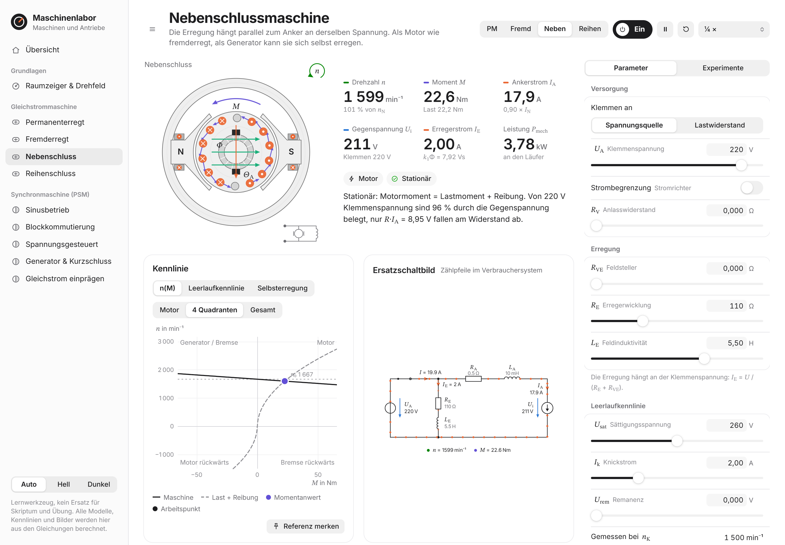
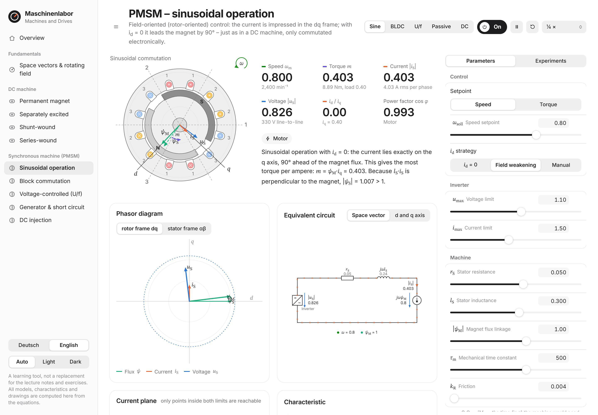

<div align="center">

# Maschinenlabor

**Electric machines, simulated live in your browser.**<br>
DC machines and permanent-magnet synchronous machines with characteristics, equivalent circuits, phasor diagrams and guided experiments.

[](https://fuchs-harry.github.io/electric-machines-model/)
[](https://github.com/fuchs-harry/electric-machines-model/actions/workflows/ci.yml)
[](LICENSE)


**[Open the live demo](https://fuchs-harry.github.io/electric-machines-model/)**

</div>

<picture>
  <source media="(prefers-color-scheme: dark)" srcset="docs/screenshots/dc-shunt-dark.png">
  
</picture>

## Why I built this

I built Maschinenlabor while preparing for my **Machines and Drives** exam (*Maschinen und Antriebe*) at TU Wien. Reading characteristic curves in the lecture notes only got me so far. I wanted to turn a knob (terminal voltage, field current, load) and immediately see what happens to speed, torque, current and the equivalent circuit. So I wrote the machine models myself and built an interface around them.

If you are studying the same material, I hope it helps you as much as it helped me. Corrections and new experiment ideas are very welcome.

## Features

**Space vectors & rotating field.** Three phase currents add up tip to tail to the space vector. Explore the locus, phase sequence, an open phase, unbalance, zero-sequence current, block currents and the rotating dq frame.

**DC machine:** permanent magnet, separately excited, shunt-wound and series-wound.
- Dynamic model (armature circuit, field circuit, mechanics): direct start, load steps, plugging
- Speed–torque characteristic with load curve, stable and unstable operating points and the moving instantaneous point
- Magnetization curve with saturation and remanence; enter your own measured points
- Self-excitation of the shunt generator with critical resistance, dynamic braking of the series machine
- Converter current limit, starting resistor, field rheostat, imposed-speed test bench

**Permanent-magnet synchronous machine** (per-unit quantities):
- Field-oriented control with PI current controllers in dq, speed controller and field weakening
- Current plane with current and voltage limits; torque–speed envelope with and without field weakening
- Block commutation (BLDC) with Hall sectors and torque ripple
- Open-loop voltage control (U/f) with load-angle curve, pull-out torque and the root locus of the linearized system
- Open circuit, short circuit and generator on a resistor
- DC injection ("compass needle")

**On every machine page:** animated cross-section, equivalent circuit with flowing current, phasor diagram, time plots, formulas with the live numbers plugged in, power balance, and **38 guided experiments**. Each one asks you to predict first, then runs, then explains the result with the numbers.

<picture>
  <source media="(prefers-color-scheme: dark)" srcset="docs/screenshots/psm-foc-dark.png">
  
</picture>

Every physical quantity has the same color everywhere: voltage blue, current orange, flux teal, torque violet, speed green. Everything else is black and white, so the physics is what stands out.

## Getting started

Use the **[live demo](https://fuchs-harry.github.io/electric-machines-model/)**, or run it locally. There is no build step and there are no dependencies.

```sh
git clone https://github.com/fuchs-harry/electric-machines-model.git
cd electric-machines-model
# either open index.html directly (double-click works), or serve the folder:
python -m http.server 8000      # → http://localhost:8000
```

Fonts (Inter, STIX Two Text) are loaded from Google Fonts. Offline, the app falls back to system fonts.

### Language

The interface is available in **English and German**. Switch in the sidebar, or link directly with `?lang=en` / `?lang=de`. Without a choice it follows the browser language.

Symbols and conventions follow the lecture in both languages: passive sign convention (*Verbraucherzählpfeilsystem*), per-unit quantities referred to peak values, and space vectors with the factor ⅔. Subscripts stay German, e.g. U<sub>A</sub> for the armature voltage and I<sub>E</sub> for the field current.

## How it works

```
index.html
css/style.css          design tokens, layout (light/dark)
js/core/               namespace, language switch (MS.L), complex numbers, RK4, eigenvalues
js/physics/            dc.js, psm.js, magnet.js (magnetization curve), loads.js – no DOM
js/ui/                 DOM helpers, controls, charts,
                       machine-art.js (cross-sections), circuits.js (equivalent circuits)
js/pages/              pages + guided experiments
tests/                 Node tests for the physics
design/                preview galleries for the machine drawings and circuits
docs/                  screenshots and social preview
```

- Every file is a classic script attached to the global `MS` namespace. That is why the app runs straight from the file system, and why the physics modules can be loaded in Node for testing.
- The models are integrated with a fourth-order Runge–Kutta method, with time steps small enough for the electrical time constants.
- Every drawing, characteristic curve and equivalent circuit is computed from the equations at runtime. The only image files in the repository are the screenshots in `docs/`.

### Model assumptions

The models are idealized, meant for understanding and not for machine design:
- no armature reaction, no iron or brush losses, ideal commutation
- non-salient PMSM (no reluctance torque)
- ideal inverters without PWM
- saturation only through the magnetization curve

Load types: hoist (active), friction, linear, fan, constant power.

## Tests

The physics is checked against hand calculations, for example:
- no-load speed and generator operation of the DC machine
- series machine with magnetization curve, self-excitation
- PMSM short circuit, sinusoidal operation, field weakening
- BLDC torque ripple, eigenvalues compared with the simulation

```sh
npm test          # or: node --test tests/physics.test.js   (Node ≥ 18)
```

The same tests run on every push and pull request via GitHub Actions.

## Contributing

Found a wrong number, a confusing explanation or a missing experiment? [Open an issue](https://github.com/fuchs-harry/electric-machines-model/issues/new/choose) or send a pull request. [CONTRIBUTING.md](CONTRIBUTING.md) covers how the code is organized, the bilingual text convention and how to add an experiment.

One rule matters more than the rest: **no content from lecture notes, exercises or exams** (no scans, figures, problem texts or exam data). Everything here is drawn and computed from scratch.

## Disclaimer

This is a personal study project, not an official TU Wien offering, and it does not replace the lecture notes or exercises. The models are simplified on purpose. If something disagrees with your course material, trust the course material, and please open an issue.

## License

[MIT](LICENSE)
